<p align="center">
  
</p>

<p align="center">
  <a href="https://www.linkedin.com/in/lucas-leonel-8273993b6/"></a>
  <a href="mailto:leonel.lucas.eng@gmail.com"></a>
  <a href="https://leetcode.com/u/lucasleonel-dev/"></a>
</p>

### `~/sobre`

Estudante de Engenharia de Software na PUC-Campinas, com foco em back-end. Gosto de construir APIs, integrações e modelos de dados, a parte que faz um produto funcionar por trás da tela. Hoje trabalho com TypeScript e Node.js (Fastify, Prisma), PostgreSQL e Docker, e estou me aprofundando em Java e Spring Boot. Uso IA generativa no dia a dia do desenvolvimento (Claude Code, Codex).

### `~/projetos`

| Projeto | O que é | Stack |
|---|---|---|
| [**Application Tracker**](https://github.com/LucasLeonel-dev/Application-tracker) | Rastreador de candidaturas a vagas. API REST com autenticação JWT, validação com Zod, rate limiting, Swagger e testes com Vitest. | Node.js · Fastify · Prisma · PostgreSQL · Docker |
| [**Relay**](https://github.com/Jp-mainieri/relay) | Agente de IA que acompanha por voz a passagem de turno em operações logísticas. Feito em 4 h no hackathon da AI Tinkerers SP (co-patrocínio OpenAI). Minha parte: dashboard em tempo real, Slack e alertas por voz. | Next.js · WebSocket · OpenAI |
| **Mescla Invest** | Plataforma para investir em startups universitárias, um dos projetos de destaque da faculdade, apresentado ao Mescla (hub de inovação da PUC-Campinas). Fui o responsável pelo banco de dados e pela autenticação com 2FA. | Firebase · Firestore · Cloud Functions · TypeScript |

### `~/stack`

<p align="left">
  
  
  
  
  
  
  
  
  
  
  
</p>

### `~/certificados`

```console
lucas@dev:~$ ls certificados/
anthropic/   ai-fluency-framework-foundations   claude-code-in-action   claude-code-101
ibm/         ia-generativa-para-desenvolvimento   classificando-dados-ibm-granite
six-sigma/   white-belt
```

```console
lucas@dev:~$ echo "obrigado pela visita!"
obrigado pela visita!
```
